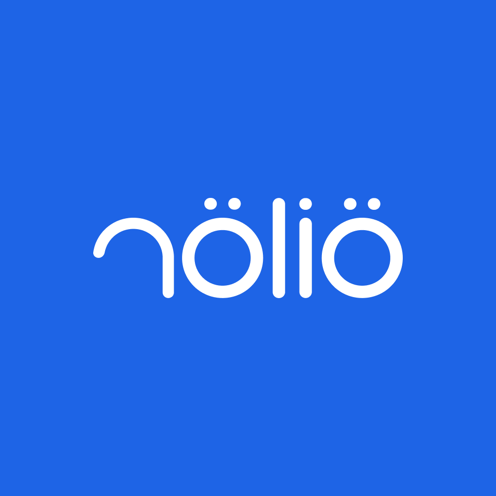

<p align="center">
  
</p>

# Nolio MCP server (official)

Official MCP server for [Nolio](https://www.nolio.io), the training platform for endurance coaches, clubs and athletes. Plan, analyze and coach endurance, strength and Hyrox training from ChatGPT, Claude or any MCP client, in plain language.

This repository only documents the server. Nolio hosts and runs it, so there is nothing to install or deploy.

```
https://mcp.nolio.io/mcp
```

Transport: Streamable HTTP. Authentication: OAuth 2.1 (sign in with your Nolio account).

Requires a paid Nolio account, coach or athlete.

## What you can do

- Read the planned and completed calendar, yours or your athletes': workouts, races, training cycles, notes and questionnaires.
- Compare what was planned with what was done: duration, distance, RPE and the athlete's debrief.
- Plan workouts for one athlete or a whole group, including structured workouts that Nolio can send to compatible watches.
- Apply workout templates from your library and create new ones.
- Follow training load, metrics (HRV, resting heart rate, sleep, weight) and intensity zones.
- Undo a creation or a deletion.

## Main tools

| Area | Tools |
| --- | --- |
| Calendar | `get_calendar`, `list_planned_trainings`, `get_planned_training`, `get_training` |
| Planning | `create_planned_training`, `create_planned_event`, `apply_training_frame`, `update_planned_training`, `update_planned_event` |
| Template library | `list_training_frames`, `get_training_frame`, `create_training_frame`, `update_training_frame`, `list_library_categories`, `list_exercises` |
| Analysis | `get_training_load`, `get_stats_chart`, `get_records`, `list_metric_values`, `list_zones` |
| Coaching | `list_athletes`, `review_training`, `read_conversations` |
| Billing | `list_athlete_subscriptions`, `list_my_invoices` |
| Deletion and undo | `delete_event`, `list_recent_deletions`, `undo_deletion` |

39 tools in total, including `nolio_api_read` and `nolio_api_write` to reach any endpoint of the [Nolio API v2](https://www.nolio.io/developers/).

## Connect

**Claude**: install Nolio from the [Claude connector directory](https://claude.ai/directory/nolio).

**ChatGPT and other MCP clients**: add a custom connector (remote MCP server) with the URL above, then sign in with your Nolio account.

## Access and safety

- You choose what the assistant may do when you sign in: read, create, update, delete.
- A coach only sees the athletes they coach. A team can restrict what its coaches can do.
- Deletions and multi-event changes go through a server-side preview step before anything is saved.
- Data from some connected services is not passed on to AI assistants, in line with those services' terms.

## Official listings

- MCP Registry: `io.nolio/nolio`
- Claude: [claude.ai/directory/nolio](https://claude.ai/directory/nolio)
- Glama: [glama.ai/mcp/connectors/io.nolio/nolio](https://glama.ai/mcp/connectors/io.nolio/nolio)
- LobeHub: [lobehub.com/mcp/nolio](https://lobehub.com/mcp/nolio)

[](https://glama.ai/mcp/connectors/io.nolio/nolio)

Other "Nolio" MCP servers are built by third parties and are not supported by Nolio.

## Support

[www.nolio.io](https://www.nolio.io)
